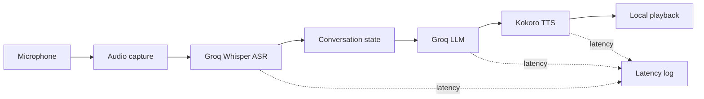

# Real-time support voice simulator

A Python voice pipeline for practicing customer-support conversations. A trainee speaks through a microphone, Groq Whisper transcribes the turn, a scenario-aware LLM produces the customer response, and Kokoro synthesizes the reply locally.

The project focuses on the orchestration boundary between audio capture, ASR, conversational state, generation, speech synthesis, playback and feedback—not on replacing a production contact-center platform.

## Conversation pipeline



Three synthetic banking scenarios are included:

- lost or stolen card;
- failed transfer;
- locked account.

Each persona file supplies the scenario context and behavior used by the conversation layer. New scenarios can be added under `config/personas` without changing the audio modules.

## Interfaces

### Streamlit

The web interface provides persona selection, explicit start/stop recording controls, conversation history, processing status and per-stage metrics.

```bash
streamlit run streamlit_app.py
```

### Command line

The CLI runs a bounded conversation for a selected persona:

```bash
python main.py --persona card_lost --turns 3
```

Available persona keys are `card_lost`, `transfer_failed` and `account_locked`.

## Local setup

The application needs Python, a working microphone and audio output. ASR and LLM calls require network access and a Groq API key. Kokoro speech synthesis runs locally but requires its native phoneme/audio prerequisites; on many systems that includes `espeak-ng`.

```bash
python -m venv .venv
source .venv/bin/activate
pip install -r requirements.txt
cp .env.example .env
```

On Windows PowerShell, activate the environment with:

```powershell
.venv\Scripts\Activate.ps1
```

Set `GROQ_API_KEY` in the local `.env`. The example file also documents model, voice, language, fallback and cost-estimation settings. Do not commit a real provider key.

Audio libraries and local TTS models can make installation platform-specific. Verify microphone permissions and audio output before diagnosing the orchestration code.

## Architecture

| Module | Responsibility |
|---|---|
| `src/asr_module.py` | Speech transcription boundary |
| `src/llm_module.py` | Scenario-aware response generation |
| `src/tts_module.py` | Local speech synthesis |
| `src/simple_voice_handler.py` | Streamlit recording and processing workflow |
| `src/voice_client.py` | CLI conversation orchestration |
| `src/state_manager.py` | Multi-turn conversation state |
| `src/persona_loader.py` | Scenario discovery and validation |
| `src/logger.py` | Stage timing and CSV latency records |
| `src/feedback.py` | Session feedback helpers |

Both entry points depend on the same modular pipeline. Provider and audio concerns stay behind their modules so conversation behavior and state can be tested without requiring a live microphone on every test.

## Observability

The pipeline records ASR, LLM and TTS timing data to `logs/latency_log.csv`. These measurements are useful for comparing stages during a local session; the repository does not provide a controlled latency benchmark or production service-level claim.

## Tests

```bash
pytest
```

The test source covers persona/state behavior, LLM-facing logic, logging and feedback, sanity checks, and voice-pipeline coordination. Mocked component tests do not establish live provider availability, transcription accuracy, speech quality or end-to-end latency on a particular machine.

## Project boundaries

- Banking scenarios and customer data are synthetic.
- Provider calls require a configured external account and may incur usage charges.
- Local playback depends on operating-system audio support and permissions.
- The Streamlit process is a demonstration interface, not a multi-user deployment.
- Latency and speech quality should be evaluated on the target hardware before making performance claims.

## Extending the simulator

Useful next steps include a scored agent rubric, saved synthetic transcripts, interruption handling, provider adapters, and a browser-native audio transport. Those are proposed extensions rather than existing functionality.
